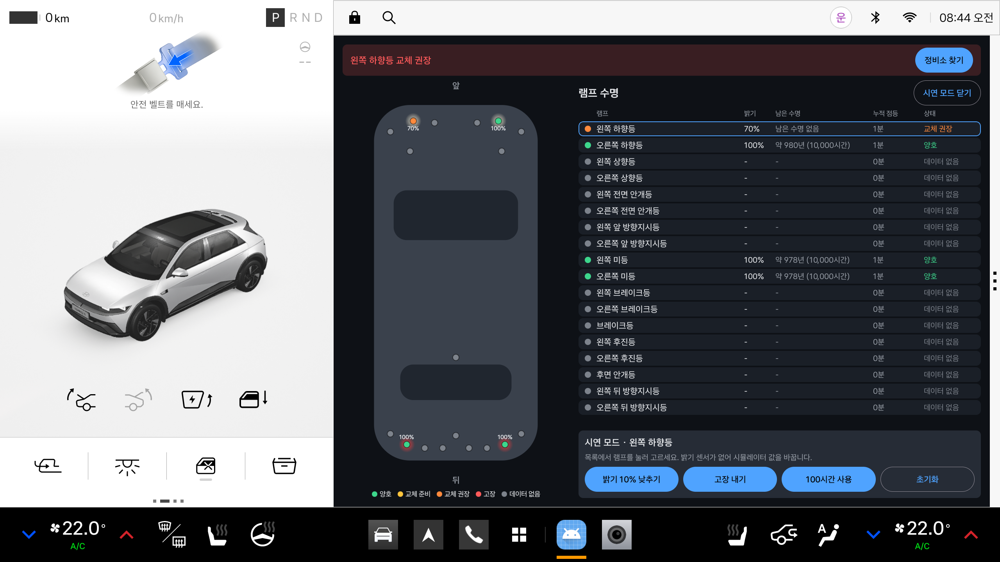

# 📌 램프체크 (LampCheck)

> ### **램프 밝기로 수명을 추정하는 Pleos Connect 차량 앱**



▶ **시연 영상**: [docs/demo/램프체크_시연영상.mp4](docs/demo/램프체크_시연영상.mp4) (2분 25초, Pleos Connect Emulator v2.1 화면 녹화, 음성 알림 소리 포함)

<br><br>
## 🏷️ 앱 이름 및 한 줄 소개

- **앱 이름**: 램프체크 (LampCheck)
- **한 줄 소개**: 타이어 공기압을 보듯 램프마다 밝기를 재서, 램프 수명이 얼마나 남았는지 운전석에서 미리 알려 주는 앱입니다.

<br><br>
## 📖 개요

램프체크는 타이어 공기압을 보듯 램프마다 밝기를 재서, 램프 수명이 얼마나 남았는지 운전석 화면에서 미리 알려 주는 앱입니다.
브레이크등이나 미등처럼 차 뒤쪽 램프는 운전자가 볼 수 없어서, 고장이 나도 차에서 내려 확인하거나 단속, 정기검사에서야 알게 되는 경우가 많습니다.
LED 램프는 갑자기 꺼지기보다 서서히 어두워지기 때문에(처음 밝기의 70%가 되는 시점을 수명 끝으로 봄), 밝기를 꾸준히 기록하면 고장 전에 교체 시점을 예측할 수 있습니다.
앱은 Pleos Vehicle SDK로 램프별 점등 시간을 쌓고, 밝기 측정값에 감쇠 곡선을 맞춰 남은 수명과 교체 예상 날짜를 계산합니다.
현대자동차그룹 차량용 앱 개발 공모전 출품작입니다.

<br><br>
## ✨ 주요 기능
- **램프 상태판**: 차를 위에서 본 그림에 램프마다 밝기(처음 대비 %)와 상태(양호, 교체 준비, 교체 권장, 고장)를 표시합니다. 차종마다 램프 구성이 달라서, Vehicle SDK로 지원을 확인한 램프만 보여 줍니다.
- **점등 시간 기록**: 하향등, 상향등, 미등, 안개등, 방향지시등, 브레이크등, 후진등이 켜져 있던 시간을 차량 신호로 쌓습니다.
- **수명 추정**: 밝기 측정값으로 감쇠 속도를 구해 남은 점등 시간과 교체 예상 날짜를 계산합니다. 측정값이 부족하면 광원별 정격 수명으로 추정합니다. 광원 종류(LED, 할로겐)는 차대번호(VIN)로 확인한 차종에 맞춰 정합니다.
- **교체 알림**: 교체 권장 단계가 되면 차가 멈췄을 때, 켜져야 할 램프가 켜지지 않으면 바로 음성으로 알립니다.
- **램프 교체 기록**: 램프를 갈고 목록에서 그 램프를 누르면 점등 시간과 밝기 기록을 지우고 새 램프 기준으로 다시 기록합니다.
- **정비소 길 안내**: 주변 정비소를 찾아 내비게이션 목적지로 보냅니다. 주행 중에는 화면 조작을 막고 음성 알림만 씁니다.
- **시연 모드**: 차량에 밝기 센서가 아직 없어서, 시뮬레이터로 밝기를 낮추거나 고장을 내고 사용 시간을 더해 수명 추정을 보여 줍니다.

<br><br>
## 📦 APK 파일 위치

- **[apk/이민하_램프체크_release.apk](apk/이민하_램프체크_release.apk)** (실행 가능한 release 버전, 약 40MB)
- 저장소 용량 제한 안이라 GitHub Release는 따로 쓰지 않았습니다.

<br><br>
## 🚀 실행 방법

1. **에뮬레이터 준비**: [Pleos Connect 에뮬레이터 설정 가이드](https://document.pleos.ai/docs/connect/guide/getting-started/application-development/setup-connect-sdk-emulator)대로 Android Studio SDK Manager의 SDK Update Sites에 Pleos Connect 시스템 이미지 사이트를 추가하고, `Pleos Connect v2.1.0`(API 34) 이미지로 Automotive AVD를 만듭니다.
2. **APK 설치**: 에뮬레이터를 켠 뒤 아래 명령으로 설치합니다.
   ```bash
   adb install apk/이민하_램프체크_release.apk
   ```
3. **앱 실행**: 에뮬레이터 앱 목록에서 **램프체크**를 열고, 처음 실행할 때 나오는 위치와 차속 권한을 허용합니다.
4. **차량 신호 바꾸기**: Virtual Console에서 하향등(Exterior Lights), 브레이크 페달, 기어, 방향지시등을 바꾸면 상태판에 켜짐 표시가 뜨고 점등 시간이 쌓입니다.
   ```bash
   adb forward tcp:8088 tcp:8088
   # 브라우저에서 http://127.0.0.1:8088 열기
   ```
5. **수명 추정 보기**: 오른쪽 위 **시연 모드**를 누르고 목록에서 램프를 고른 뒤 `밝기 10% 낮추기`, `고장 내기`, `100시간 사용`, `초기화`를 눌러 봅니다. 시연 모드를 닫고 목록에서 램프를 누르면 램프 교체를 기록할 수 있습니다.

<br><br>
## 🧪 테스트 환경 및 필요한 설정

| 항목 | 내용 |
|---|---|
| 에뮬레이터 | Pleos Connect Emulator v2.1.0 (Android 14, API 34), AVD RAM 4GB, Cold boot, 하드웨어 가속(Windows는 WHPX) |
| 권한 | 앱 실행 시 위치(`pleos.car.permission.FUSED_LOCATION`), 차속(`android.car.permission.CAR_SPEED`) 허용 |
| 차량 신호 | Virtual Console(에뮬레이터 포트 8088)로 램프, 브레이크, 기어, 방향지시등 변경 |
| 램프 밝기 | Pleos SDK에 아직 밝기 값이 없어 앱 안의 밝기 센서 시뮬레이터(시연 모드)로 대신합니다 |
| 정비소 검색 (선택) | 카카오 REST API 키가 필요합니다. 제출한 APK에는 키가 없어 정비소 목록 대신 키 안내 문구가 보입니다 |
| 빌드 환경 | JDK 17, Android SDK 35, Gradle 8.10.2 (AGP 8.8.2), Kotlin 2.0.0 |

**소스에서 빌드할 때**
```bash
# local.properties
# sdk.dir=<Android SDK 경로>
# KAKAO_REST_API_KEY=<카카오 REST API 키>   (선택)
./gradlew assembleDebug
adb install app/build/outputs/apk/debug/app-debug.apk
```
- Windows에서 프로젝트 경로에 한글이 있으면 Android Gradle 플러그인이 빌드를 거부하므로 영문 경로에서 빌드합니다.

**자동 테스트**
- `./gradlew testDebugUnitTest`: 단위·회귀 테스트 52개 (수명 추정, 점등 시간 누적, 밝기 시뮬레이터, 교체 알림, 차종 프로필)
- `./gradlew connectedDebugAndroidTest`: 에뮬레이터 기기 테스트 9개 (Vehicle SDK 램프, 방향지시등, 브레이크, 기어, 주행 제한 신호 수신)
- 2026-11-10 Pleos Connect v2.1 에뮬레이터에서 모두 통과했습니다.

<br><br>
## 🛠️ 기술 스택

| 구분 | 도구 / 프레임워크 |
|---|---|
| OS | Pleos Connect (Android Automotive OS 14) |
| 언어 | Kotlin |
| 프레임워크 | Jetpack Compose, Kotlin Coroutines |
| SDK | Pleos Vehicle, TextToSpeech, FusedLocation, NaviHelper SDK, AAOS Car API |
| 개발 환경 | Gradle 8.10.2, AGP 8.8.2, JDK 17, Pleos Connect Emulator v2.1 |
| 외부 API | 카카오 로컬 키워드 검색 (정비소 검색) |

<br><br>
## 📂 프로젝트 구조

```bash
.
├── apk/                              # 실행 가능한 release APK
├── app/src/main/java/io/github/ggoneng/lampcheck/
│   ├── model/Lamp.kt                 # 램프 종류, 광원, 수명 상태 모델
│   ├── vehicle/                      # Vehicle SDK와 Car API로 램프, 브레이크, 기어, 차속 신호 받기
│   ├── usage/LampUsageTracker.kt     # 램프별 누적 점등 시간과 교체 기록
│   ├── lifespan/                     # 감쇠 곡선 맞춤, 남은 수명 계산, VIN 차종 프로필
│   ├── sensor/                       # 밝기 센서 인터페이스와 시뮬레이터
│   ├── alert/ReplacementAlert.kt     # 교체, 고장 음성 알림
│   ├── data/LampDataStore.kt         # 점등 시간과 밝기 기록 저장
│   ├── navi/                         # 현재 위치, 정비소 검색, 길 안내
│   ├── voice/                        # TTS 음성 안내
│   ├── ui/                           # 상태판, 정비소 화면
│   └── [...]
├── app/src/test/                     # 단위·회귀 테스트
├── app/src/androidTest/              # 에뮬레이터 기기 테스트
└── docs/                             # 화면 캡처, 시연 영상, 에뮬레이터 신호 주입 방법
```

<br><br>
## 📝 한계와 향후 계획
- 램프 밝기 값은 지금 Pleos SDK에 없어서 시뮬레이터로 대신합니다. Pleos와 협의해 Vehicle SDK의 램프별 밝기 속성으로 연동할 계획입니다.
- 차종별 램프 광원 사양을 아직 받지 못해, 모든 차를 기본 사양(후진등과 뒤 방향지시등만 할로겐)으로 추정합니다. 사양을 받으면 VIN 앞자리별로 더할 계획입니다.
- 앱이 화면 뒤로 가면 시스템이 앱을 멈춰 점등 시간이 쌓이지 않습니다. foreground service로 바꿀 계획입니다.
- 주행 중 화면 표시를 위한 Distraction Optimization 선언과 심사가 필요합니다.
- 안개등은 에뮬레이터에 신호가 없어 확인하지 못했고, 카카오 키 없이 정비소 검색과 길 안내는 확인하지 못했습니다.
- SDK의 램프 점등 상태가 실제 점등을 감지한 값인지는 실차에서 확인해야 합니다.
